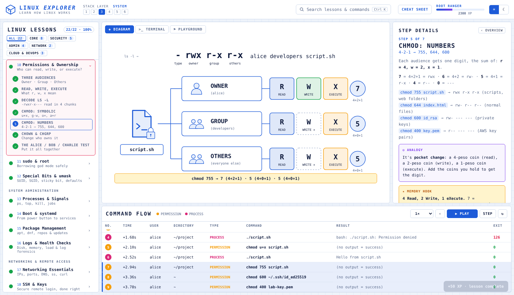

# 🐧 Linux Explorer — learn how Linux works

An interactive, step-by-step Linux course for **Cloud, DevOps and Cyber Security** learners.
Every lesson walks you through a process with an **animated diagram**, a **simulated terminal**, a **command-flow log**, plain-English **analogies**, **memory hooks**, **trigger words**, a **quiz**, and (in 9 lessons) a hands-on **playground challenge**.

> Created by **Raul** ([@rmctech-ai](https://github.com/rmctech-ai)) · Freelance AI Automation Specialist on the path to Cloud Security.
> Companion course: [Python Explorer](https://github.com/rmctech-ai/python-explorer).
> 🏠 Part of **[Raul's Cloud Learning Hub](https://rmctech-ai.github.io/)** · Live course: https://rmctech-ai.github.io/Linux-Explorer/
> The Explorer course format is inspired by [Protocol Explorer](https://protocol-explorer-alpha.vercel.app/) by Dilum Sanjaya. All lessons, labs and study tools are my own work.



---

## ▶ Run it

No build step, no dependencies. It's plain HTML/CSS/JS.

```bash
# option 1: just open it
open index.html            # macOS
xdg-open index.html        # Linux
start index.html           # Windows

# option 2: local web server (recommended)
python3 -m http.server 8000
# then visit http://localhost:8000
```

### Publish on GitHub Pages
```bash
git init
git add .
git commit -m "Linux Explorer: interactive Linux course"
git branch -M main
git remote add origin https://github.com/rmctech-ai/linux-explorer.git
git push -u origin main
```
Then on GitHub: **Settings → Pages → Source: Deploy from a branch → `main` / root → Save**.
Your course will be live at `https://rmctech-ai.github.io/linux-explorer/`.

---

## 🧭 How to use it

| Area | What it does |
|---|---|
| **Linux Lessons** (left) | 22 lessons grouped by track. Click a lesson to expand its steps. Dots show progress (amber = started, green = done). |
| **Diagram** tab | Animated scene for each step: data flowing between nodes, the filesystem tree, or the rwx permission grid. |
| **Terminal** tab | Types out the real commands for the current step with realistic output. |
| **Playground** tab | A safe fake Linux shell (users alice/bob/charlie, real permission checks, pipes, `>`/`>>`, sudo). Lessons with a ⚑ challenge auto-check your work. |
| **Step Details** (right) | Explanation, command card, **Analogy**, **Memory Hook**, **Trigger Words**, cloud/security notes, warnings. |
| **Command Flow** (bottom) | Wireshark-style log of every command so far: user, directory, type, result, **exit code**. Click a row to replay it. |
| **XP & levels** | +10 per new step, +50 per lesson, +20 per correct answer, +40 per challenge. From NEWBIE to KERNEL KNIGHT. Saved in your browser. |
| **Cheat Sheet** | One-page revision of every lesson's master hook and key commands (also in [`CHEATSHEET.md`](CHEATSHEET.md)). |

**Keyboard:** `→` next step · `←` previous · `Space` play/pause · `Ctrl+K` search · `Esc` close. Deep links work: `index.html#permissions/4`.

---

## 📚 Curriculum (22 lessons · 120 steps · 89 quiz questions)

| # | Lesson | Track | You'll learn |
|---|---|---|---|
| 01 | What is Linux? | Foundations | kernel, distros, shell, "everything is a file" |
| 02 | Terminal & Shell | Foundations | prompt anatomy, command grammar, man, shortcuts, $PATH |
| 03 | The Filesystem Map | Foundations | /, /etc, /home, /root, /var/log, /usr/bin, /proc, /tmp |
| 04 | Moving Around ⚑ | Foundations | pwd, ls -lah, cd, absolute vs relative, . .. ~ - |
| 05 | Files & Directories ⚑ | Foundations | mkdir -p, touch, cp, mv, rm, wildcards |
| 06 | Reading & Editing ⚑ | Foundations | cat, less, head, tail -f, nano, vim survival |
| 07 | Search: find & grep ⚑ | Power tools | find by name/type/size/time, grep -rinvc |
| 08 | Pipes & Redirection ⚑ | Power tools | stdin/stdout/stderr, > >> 2> \|, sort \| uniq -c |
| 09 | Users & Groups ⚑ | Security | UID, /etc/passwd & shadow, groups, usermod -aG, service accounts |
| 10 | Permissions & Ownership ⚑ | Security | UGO × RWX, 4-2-1, chmod 755/644/600/400, chown |
| 11 | sudo & root ⚑ | Security | least privilege, sudoers, visudo, audit logs |
| 12 | Special Bits & umask | Security | SUID, SGID, sticky bit, umask, privilege escalation hunting |
| 13 | Processes & Signals | Admin | PID, ps, top, kill -15 vs -9, jobs, nohup |
| 14 | Boot & systemd | Admin | boot chain, systemctl, enable vs start, journalctl, unit files |
| 15 | Package Management | Admin | apt vs dnf, update vs upgrade, patching & shared responsibility |
| 16 | Logs & Health Checks | Admin | df, du, free, load average, auth.log forensics, CloudWatch |
| 17 | Networking Essentials | Network | ip, ping, ss -tulpn, DNS, curl, troubleshooting ladder |
| 18 | SSH & Keys | Network | key pairs, authorized_keys, ~/.ssh/config, scp/rsync, hardening |
| 19 | Hardening a Server | Security | ufw, fail2ban, audit checklist, attack surface |
| 20 | Bash Scripting & Cron ⚑ | Cloud & DevOps | shebang, variables, if/for, exit codes, crontab |
| 21 | Linux on AWS EC2 | Cloud & DevOps | AMIs, key pairs, user data, IMDSv2, SSM, shared responsibility |
| 22 | Containers Under the Hood | Cloud & DevOps | namespaces, cgroups, image layers, containers vs VMs |

⚑ = has a playground challenge.

---

## 🗂 Project structure

```
linux-explorer/
├── index.html              # app shell (header, 4 panels, modals)
├── css/style.css           # blueprint theme, light + dark
├── js/
│   ├── app.js              # navigation, rendering, XP, search, cheat sheet
│   ├── diagram.js          # SVG scene engine: graph / tree / perm
│   ├── icons.js            # line icons used by diagrams
│   ├── sandbox.js          # simulated shell + virtual filesystem
│   └── lessons/            # ALL course content lives here
│       ├── 01-foundations.js   (lessons 1-6)
│       ├── 02-files.js         (7-8)
│       ├── 03-security.js      (9-12)
│       ├── 04-system.js        (13-16)
│       ├── 05-network.js       (17-18)
│       └── 06-devops.js        (19-22)
├── tools/
│   ├── validate.js         # checks lesson data for broken references
│   └── build-cheatsheet.js # regenerates CHEATSHEET.md
├── CHEATSHEET.md
└── docs/screenshots/
```

## ✍️ Add or edit a lesson

Lessons are plain JavaScript objects. Copy one in `js/lessons/` and change it:

```js
LESSONS.push({
  id: 'my-lesson', num: 23, cat: 'cloud', layer: 4,       // cat: core|security|admin|network|cloud
  title: 'My Lesson', short: 'one-line subtitle',
  overview: '<p>…</p>', hook: 'master memory hook', why: 'why it matters',
  scene: { type: 'graph', nodes: [{ id: 'a', x: 150, y: 240, icon: 'server', label: 'A' }], edges: [] },
  steps: [{ t: 'Title', sub: 'subtitle', body: '<p>…</p>', analogy: '…', hook: '…', words: ['…'],
            flow: { from: 'a', to: 'b', label: 'LABEL', detail: ['line'], color: 'green' },
            cmds: [{ c: 'ls -l', o: 'output', k: 'nav' }] }],
  summary: { title: '…', text: '…' }, quiz: [{ q: '?', a: ['x', 'y'], c: 0, why: '…' }],
  cheat: [['cmd', 'what it does']], next: 'cliffhanger for the next lesson'
});
```
Then run `node tools/validate.js js/lessons` and `node tools/build-cheatsheet.js`.

Scene types: **graph** (nodes + animated flow), **tree** (`items: [[depth, name, comment, 'd'|'f', appearAt, hideAt]]`), **perm** (`mode: '-rwxr-x---'`, per-step `perm.focus: owner|group|others`).

---

## 🎯 Suggested study plan (after the CCP exam)

- **Week 1:** Lessons 1–8 (foundations + power tools). Do every playground challenge.
- **Week 2:** Lessons 9–12 (identity & permissions). This is the security core.
- **Week 3:** Lessons 13–18 (admin + networking). Practice on a free-tier EC2 instance.
- **Week 4:** Lessons 19–22 (hardening, scripting, AWS, containers). Then the capstone project below.

**Capstone:** Launch an EC2 instance → harden it (L19) → deploy a small app as a systemd service (L14) → automate backups with cron (L20) → ship logs to CloudWatch (L16) → write it up in this repo.

## License
MIT © 2026 Raul (rmctech-ai). Use it, fork it, teach with it.
